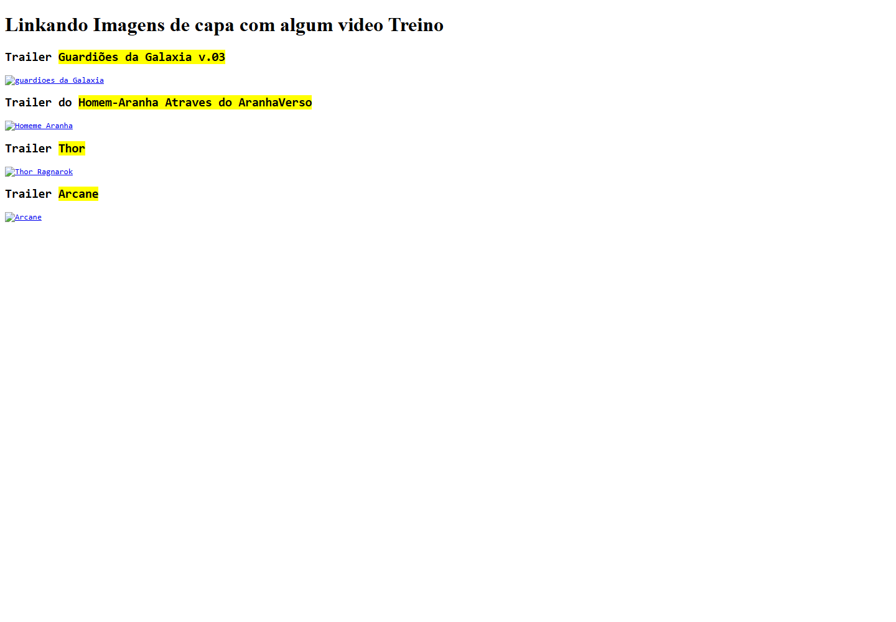

# HTML · Navegação entre páginas e vídeos

Registro de um exercício inicial de HTML5: conectar páginas por links, usar imagens como entrada de navegação e incorporar vídeos externos.

**Estado:** acervo de estudos arquivado. O código e o histórico são preservados como parte do aprendizado, sem manutenção ativa.

## Objetivo e tecnologias

O exercício pratica elementos `a`, `img` e `iframe`, links internos/externos e uma estrutura com uma página inicial e páginas de conteúdo. Não usa framework ou backend.

| Arquivo | Conteúdo |
|---|---|
| [index.html](index.html) | Entradas de navegação para os vídeos. |
| [guardioes.html](guardioes.html) | Página de vídeo e retorno ao menu. |
| [homemaranha.html](homemaranha.html) | Página de vídeo e retorno ao menu. |
| [thor.html](thor.html) | Página de vídeo e retorno ao menu. |
| [arcene.html](arcene.html) | Página de vídeo e retorno ao menu. |

## Registro visual

Captura real da versão arquivada. As capas referenciadas na pasta `capa/` estão ausentes; não foram substituídas por imagens de outro projeto.

## Consultar localmente

Abra `index.html` no navegador. Para os vídeos, é necessário acesso ao serviço externo do YouTube. Este material é um exercício básico, sem layout responsivo completo.
